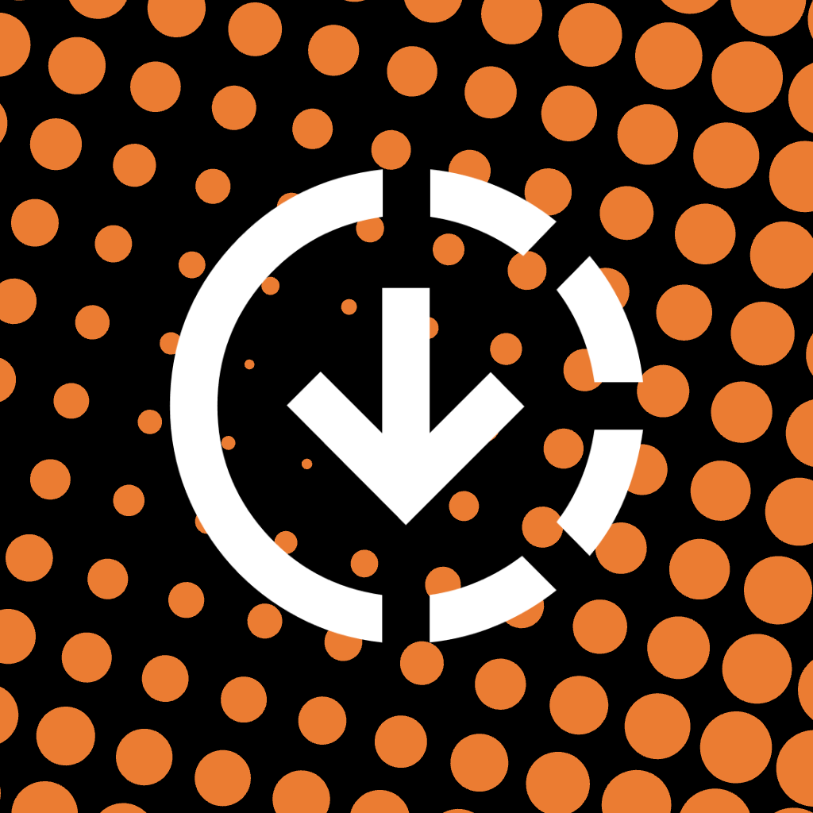

<div align="center">



# SwiftInstaller

**Install SwiftStore, or SwiftStore together with SwiftContainer, on your iPhone. No PC required.**

[](#requirements)
[](LICENSE.md)

An app by [theccraft-git](https://github.com/theccraft-git). Special thanks to [Frizzle](https://github.com/FrizzleM/SideInstaller) for building the core app, SideInstaller.

</div>

---

SwiftInstaller is a fork of [SideInstaller](https://github.com/FrizzleM/SideInstaller). It does the same job: the first install of a sideloading setup, entirely on the phone. SideStore and LiveContainer normally need a computer for that first install. This app signs in with your Apple ID, downloads the IPA, pairs the phone, and installs the app over a local tunnel.

The fork changes what you see and what the installer offers. The app, its icon, and the install page use an orange palette. The choices in the installer are **SwiftStore** and **SwiftStore + SwiftContainer**.

## How the app works

You install SwiftInstaller itself from the install page. That page lists one signed copy per certificate. Safari installs the copy you tap. After that, everything else happens inside the app.

1. **Sign in.** Your Apple ID is used on the phone to ask Apple for a development certificate and provisioning profile. The password stays on the device. It is not sent to this project.
2. **Choose what to install.** The picker offers SwiftStore, SwiftStore + SwiftContainer, Madeira, or an IPA you supply. Stable and nightly tracks are available for the first two.
3. **Download the IPA.** SwiftInstaller fetches the release from GitHub and keeps it on the phone.
4. **Connect.** The install travels through LocalDevVPN (or another VPN that provides the same loopback tunnel). On iOS 27 the phone can pair itself and show the code in the Dynamic Island and on the Lock Screen. On iOS 17.4 through 26, you import a pairing file that was created on a computer.
5. **Install and hand off.** The app is signed with your certificate and installed through that tunnel. SwiftInstaller then writes the pairing file into the installed app so it can keep refreshing itself.

After that, you use SwiftStore (and SwiftContainer, if you chose it) as the sideloading apps. SwiftInstaller is the bootstrap, not the store you keep installing apps with.

## What changed from SideInstaller

SideInstaller installs **SideStore**, or **SideStore + LiveContainer**. This fork keeps that installer and presents those choices under new names, in a new colour.

| | SideInstaller | SwiftInstaller |
| --- | --- | --- |
| App name | SideInstaller | SwiftInstaller |
| Colour | Blue | Orange. Coral `#E95F3C`, wing `#F0753F`, deep ember behind the icons. Light, Dark, and Tinted app icons, the in-app section icons, and the install page all use that palette. |
| First choice | SideStore | SwiftStore |
| Second choice | SideStore + LiveContainer | SwiftStore + SwiftContainer |
| Author | Frizzle | theccraft-git, with thanks to Frizzle for the core app |

The names on the picker are SwiftStore and SwiftContainer. The files that get downloaded are still the upstream releases, because those projects publish under their original names:

- **SwiftStore** downloads `SideStore.ipa` from [SideStore/SideStore](https://github.com/SideStore/SideStore).
- **SwiftStore + SwiftContainer** downloads `LiveContainer+SideStore.ipa` from [LiveContainer/LiveContainer](https://github.com/LiveContainer/LiveContainer).

The installed apps still show SideStore and LiveContainer on the Home Screen. Pairing looks for those names, which is what the IPAs are actually called. Madeira is unchanged.

Discord, Ko-fi, and crypto donations from the original project are not in this fork.

## How to use it

1. Open this repo's install page and install SwiftInstaller with any certificate listed there.
2. Open the app and connect LocalDevVPN.
3. Sign in with your Apple ID.
4. Choose **SwiftStore** or **SwiftStore + SwiftContainer**.
5. Tap **Install** and wait.

## Requirements

| iOS | Compatible? |
| --- | --- |
| 27 and later | Yes. The phone can pair itself. |
| 17.4 – 26 | Yes, with a [pairing file](https://docs.sidestore.io/docs/advanced/alternative#pairing) made on a computer. |
| Older than 17.4 | No. |

You also need Wi-Fi the first time, and an Apple ID. A Mac or PC is only required when the iOS version cannot pair itself.

## Building and publishing

The Xcode project is not committed. Generate it, then build:

```sh
./build-rust.sh
xcodegen generate
```

GitHub Actions can do that on a Mac runner. **build-ipa** compiles an unsigned `SwiftInstaller.ipa` and can publish it as a release. **sign-sideinstaller** signs that IPA with every certificate in the pool and regenerates the install page. See the comments at the top of `.github/workflows/build-ipa.yml` and `.github/workflows/sign-sideinstaller.yml`.

| Path | What it is |
| --- | --- |
| `ios-app/` | SwiftUI app: install flow, certificates, translations |
| `ios-live-activity/` | Lock Screen and Dynamic Island pairing code |
| `rust-core/` | Rust core, built into `SideInstallerFFI.xcframework` |
| `scripts/` | IPA export, signing, and install-page generation |
| `.github/` | Workflows that build, sign, and publish |

## Credits

SwiftInstaller is by [theccraft-git](https://github.com/theccraft-git/SwiftInstaller).

Special thanks to [Frizzle](https://github.com/FrizzleM/SideInstaller) for building the core app, SideInstaller. The pairing, tunnel, and on-device signing come from that project and from [idevice](https://github.com/jkcoxson/idevice) (jkcoxson) and [isideload](https://github.com/nab138/isideload) (nab138).

## License

See [LICENSE.md](LICENSE.md). You may read, modify, and share the source, with attribution, for non-commercial purposes. Redistributing the official IPAs, or monetizing the project, needs written permission.
